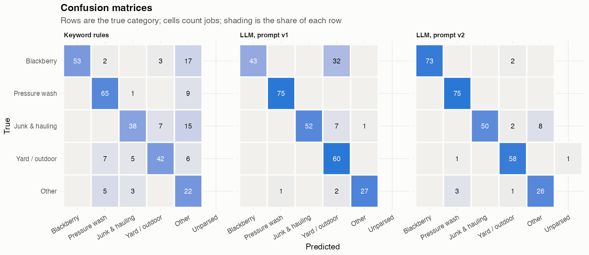

<!-- README.md is generated from README.Rmd. Edit the .Rmd, then run: Rscript -e 'knitr::knit("README.Rmd")' -->

```{r setup, include = FALSE}
knitr::opts_chunk$set(echo = FALSE, message = FALSE, warning = FALSE)
source("R/04_analysis.R")
pct  <- function(x) paste0(floor(x * 100), "%")
o    <- function(clf, col) overall[[col]][overall$classifier == clf]
kw_err  <- sum(keyword_errors$errors)
kw_none <- sum(keyword_errors$errors[keyword_errors$fired == "(nothing matched)"])
bb_n      <- sum(d$true_label == "Blackberry removal")
bb_yard   <- sum(d$true_label == "Blackberry removal" & d$llm == "Yard / outdoor work")
bb_canon  <- sum(d$true_label == "Blackberry removal" & d$style == "canonical")
bb_canon_miss <- sum(d$true_label == "Blackberry removal" & d$style == "canonical" & d$llm != "Blackberry removal")
api_s  <- function(x) floor(x / 100) / 10
bb_yard2  <- sum(d$true_label == "Blackberry removal" & d$llm2 == "Yard / outdoor work")
junk_n    <- sum(d$true_label == "Junk removal & hauling")
junk_oth2 <- sum(d$true_label == "Junk removal & hauling" & d$llm2 == "Other")
unparsed2 <- sum(d$llm2 == "Unparsed")
v2n <- function(a, b) { v <- v2_change$n[v2_change$v1_right == a & v2_change$v2_right == b]; if (length(v)) v else 0L }
tally <- function(w) { v <- disagree_tally$n[disagree_tally$winner == w]; if (length(v)) v else 0L }
```

# Keyword rules vs an LLM: classifying field-service job notes in R

My [field-service app](https://github.com/BrennanKM/field-service-client-directory) sorts free-text job notes ("cleared blackberries behind the shed, 3 loads to the dump") into five service categories so its Stats view can report revenue and $/hour by service line. It does that with a short list of keyword rules. Jobs get their service from a picker (Blackberry removal, Pressure washing, Junk removal, Dump run, Yard work, Other) or a free-text box. This project asks whether an LLM does the job better, what it gets wrong, and what it costs per job.

**Short answer:** on `r nrow(d)` synthetic job notes, the keyword rules got **`r pct(o("Keyword rules", "accuracy"))`** right and the LLM (`r unique(llm$model)`) got **`r pct(o("LLM, prompt v1", "accuracy"))`**. The rules are near-perfect on wording like the picker's (`r pct(o("Keyword rules", "canonical"))`) and fall apart on shorthand, synonyms and typos (`r pct(o("Keyword rules", "variant"))`). The LLM handles that variation much better, but it has a blind spot of its own: it filed `r bb_yard` of `r bb_n` blackberry jobs as general yard work, including notes that say "Blackberry removal" word for word. I rewrote the prompt once, adding three rules for close calls and six examples (prompt v2). That cut the blackberry mistake to `r bb_yard2` and raised the LLM to **`r pct(o("LLM, prompt v2", "accuracy"))`**. It's an optimistic number, because I wrote v2 after reading v1's mistakes on these same notes.

The LLM costs about $`r sprintf("%.2f", floor(min(llm_cost$cost_per_1k, llm2_cost$cost_per_1k) * 100) / 100)` to $`r sprintf("%.2f", floor(max(llm_cost$cost_per_1k, llm2_cost$cost_per_1k) * 100) / 100)` per 1,000 notes and about `r api_s(llm_cost$api_median)` seconds of model time per note; the rules are free and take about `r floor(kw_us_per_row * 10) / 10` microseconds.

## Data

All `r nrow(d)` job notes are **synthetic**. No real client, address, phone number or job record is in this repo. `R/01_make_data.R` writes them from templates with a fixed seed, and each template carries its true category. [LABELING.md](LABELING.md) has the labeling rule and category definitions.

```{r data-table}
d |>
  count(true_label, style) |>
  pivot_wider(names_from = style, values_from = n, values_fill = 0) |>
  mutate(total = canonical + variant) |>
  rename(`True category` = true_label, Canonical = canonical, Variant = variant, Total = total) |>
  knitr::kable()
```

*Canonical* notes start from a picker name ("Pressure washing driveway", "Dump run, a couch"). *Variant* notes use shorthand, synonyms, combined jobs or a typo.

## Method

| | Keyword rules | LLM |
|---|---|---|
| What it is | `classifyService()` from the app, ported to R in [`R/keyword_classifier.R`](R/keyword_classifier.R). First matching regex wins. | `r unique(llm$model)`, one call per note, via the Claude Code CLI in print mode with no tools ([`R/03_run_llm.R`](R/03_run_llm.R)). |
| Input | The note | The note, plus a system prompt. [Prompt v1](prompts/v1.txt) gives the five category definitions. [Prompt v2](prompts/v2.txt) adds three rules for close calls and six examples; see [Fixing the prompt](#fixing-the-prompt). |
| Check | [`R/02_check_port.R`](R/02_check_port.R) runs the original JavaScript on every note; the R port matches it on all `r nrow(d)`. | Replies are matched to a category name; `r sum(d$llm == "Unparsed") + sum(d$llm2 == "Unparsed")` of `r 2 * nrow(d)` didn't match. |

**Hybrid** rows are computed from the same predictions with no extra calls: use the keyword rules, and only call the LLM when the rules return `Other`.

## Results

```{r overall-table}
overall |>
  transmute(Classifier = classifier,
            Accuracy = pct(accuracy),
            `Macro F1` = sprintf("%.2f", floor(macro_f1 * 100) / 100),
            `Canonical notes` = pct(canonical),
            `Variant notes` = pct(variant)) |>
  knitr::kable(align = "lrrrr")
```

Both hybrids send `r pct(hybrid_llm_share)` of notes to the LLM.


### Confusion matrices



### Precision and recall by category

```{r pr-table}
per_class |>
  filter(classifier %in% THREE) |>
  transmute(classifier, Category = class,
            PR = paste(if_else(is.na(precision), "n/a", pct(precision)), "/", pct(recall))) |>
  pivot_wider(names_from = classifier, values_from = PR) |>
  rename_with(~ paste0(.x, ", precision / recall"), -Category) |>
  knitr::kable(align = "lrrr")
```


## Where they disagree

This section compares the keyword rules with the LLM on prompt v1. The two gave different answers on `r nrow(disagree)` of `r nrow(d)` notes. The LLM was right on `r tally("LLM right")` of them, the keyword rules on `r tally("Keyword rules right")`, and both were wrong on `r tally("Both wrong")`.

**Why the keyword rules miss.** Each row below is one keyword that sent notes to the wrong category, with one example note.

```{r kw-errors}
keyword_error_examples |>
  transmute(`Keyword that fired` = paste0("`", fired, "`"),
            Errors = errors,
            `Example note` = description,
            `True` = true_label,
            `Rules said` = keyword) |>
  knitr::kable()
```

Two kinds of miss. `r kw_none` of the rules' `r kw_err` misses are notes no rule matched ("bramble", "berry vines", "PW", "moss"), so they fall to `Other`. The other `r kw_err - kw_none` are a rule firing on the wrong word: place words like `yard`, `driveway`, `deck` and `patio` describe where the job was, not what was done, and plain substrings catch too much (`move` inside "removed", `bed` inside "flower beds" and "bedroom", `wash` in window washing). Because the rules run in order, a place word in an early rule wins over the real service in a later one.

**Where the LLM (prompt v1) misses.** Grouped by the mistake, with one example note each.

```{r llm-errors}
llm_errors |>
  group_by(true_label, llm) |>
  summarise(Errors = n(), `Example note` = first(description), .groups = "drop") |>
  arrange(desc(Errors)) |>
  transmute(`True` = true_label, `LLM said` = llm, Errors, `Example note`) |>
  knitr::kable()
```

The big one is blackberry work filed as yard work: `r bb_yard` of `r bb_n` blackberry jobs, and `r bb_canon_miss` of the `r bb_canon` that use the plain picker wording. The system prompt defines Blackberry removal as its own category, and the model still folded it into the broader one. It also tends to read "yard debris" as yard work when the job was hauling it away. The keyword rules never misfile a note that contains "blackberr", because that rule is checked first.

The full disagreement list is in [`data/disagreements.csv`](data/disagreements.csv).

```{r write-disagreements}
disagree |>
  select(id, description, true_label, keyword, llm, winner) |>
  write_csv("data/disagreements.csv")
```

## Fixing the prompt

Prompt v1 gave the model the five category definitions and nothing else. [Prompt v2](prompts/v2.txt) keeps those and adds:

- **Three rules for close calls:** blackberry clearing is its own service line, not a kind of yard work; taking something away is hauling even when it came from a yard; a place in the note says where the job was, not what was done.
- **Six examples,** one or two per category. None of them appear in the test notes (checked by string match), but I wrote them after seeing v1's mistakes, so they target exactly those mistakes.

```{r v2-change}
tibble(
  ` ` = c("Wrong on v1, right on v2", "Right on v1, wrong on v2", "Wrong on both", "Right on both"),
  Notes = c(v2n(FALSE, TRUE), v2n(TRUE, FALSE), v2n(FALSE, FALSE), v2n(TRUE, TRUE))
) |>
  knitr::kable(align = "lr")
```

The blackberry fix worked: `r bb_yard` misfiles became `r bb_yard2`. But the change wasn't free. v2 broke `r v2n(TRUE, FALSE)` notes v1 had right, and its biggest new mistake is hauling jobs filed as `Other` (`r junk_oth2` of `r junk_n`). Most are jobs like "Took a busted treadmill to the transfer station" or "Removed two old appliances from the basement", where the note says what was moved but not the word "haul" or "junk". `r if (unparsed2 > 0) paste0(unparsed2, " v2 reply explained its answer instead of giving just the category name; it's counted as wrong.") else ""`

**Where the LLM (prompt v2) still misses.**

```{r llm2-errors}
llm2_errors |>
  group_by(true_label, llm2) |>
  summarise(Errors = n(), `Example note` = first(description), .groups = "drop") |>
  arrange(desc(Errors)) |>
  transmute(`True` = true_label, `LLM said` = if_else(llm2 == "Unparsed", "(not a category)", llm2), Errors, `Example note`) |>
  knitr::kable()
```

With v2, the hybrid (`r pct(o("Hybrid, v2", "accuracy"))`) now trails the LLM alone. Once the LLM handles blackberry work, the hybrid's weak spot is that it trusts the rules whenever any keyword matches, including the `r kw_err - kw_none` notes where the rules matched the wrong word.

## Cost and latency

```{r cost-table}
cost_col <- function(x) c(
  sprintf("$%.2f", floor(x$cost_per_1k * 100) / 100),
  paste0(api_s(x$wall_median), " s (API alone: ", api_s(x$api_median), " s)"),
  paste0(api_s(x$wall_p90), " s (API alone: ", api_s(x$api_p90), " s)"),
  paste0(floor(x$in_tok_mean), " / ", floor(x$out_tok_mean)),
  "No")
tibble(
  ` ` = c("Cost per 1,000 notes", "Median time per note", "90th percentile time per note",
          "Tokens per call (in / out)", "Runs offline"),
  `Keyword rules` = c("$0", paste0(floor(kw_us_per_row * 10) / 10, " µs"), "", "n/a", "Yes"),
  `LLM, prompt v1` = cost_col(llm_cost),
  `LLM, prompt v2` = cost_col(llm2_cost)
) |>
  knitr::kable(align = "lrrr")
```

LLM cost is the per-call figure the CLI reports at API prices, summed over `r llm_cost$calls` calls per prompt. Input tokens include context the CLI adds on top of my prompt, so a direct API call with the same prompt would send fewer tokens and cost less. Wall-clock time is for one CLI call with 4 calls running at once, including process start; "API alone" is the time the CLI reports waiting on the model. Prompt v2 is longer, yet the CLI reported a lower cost per call; I didn't save the token-cache breakdown that would explain why. Keyword time is the R port, averaged over `r format(reps * nrow(d), big.mark = ",", scientific = FALSE)` classifications.

## What I'd do with this

- **For jobs logged from the picker,** the rules are the right tool: close to perfect, free and instant. The LLM on prompt v1 was worse on these notes because of the blackberry mistake, and prompt v2 only tied the rules.
- **For jobs typed by hand,** the rules misfile without any warning, and that skews the revenue-by-service and $/hour charts the app exists to produce. The cheapest fix is word boundaries (`\bmove\b`, `\bbeds?\b`), dropping place words from the rules, and a few synonyms.
- **An LLM isn't a drop-in upgrade.** With the first prompt it was better overall but wrong in a consistent direction on the business's main service line. That's the kind of error that moves a revenue-by-service chart, and it only showed up because the results were checked against labels.
- **Prompt fixes trade errors, they don't just remove them.** v2 fixed `r v2n(FALSE, TRUE)` notes and broke `r v2n(TRUE, FALSE)`. Checking only the notes you set out to fix would have missed the new hauling mistake.
- **What I'd ship:** the rules for jobs logged from the picker, and the LLM with prompt v2 for typed notes, after a test on fresh notes it was never tuned on. The `r pct(o("LLM, prompt v2", "accuracy"))` won't hold up exactly on notes it hasn't seen.

## Limits

- The notes are synthetic, so the accuracy numbers describe how each classifier handles this kind of variation, not how often that variation shows up in real job logs.
- I wrote both the templates and the labels. The LLM was given the same category definitions I labeled with; the keyword rules were written earlier from real notes. The LLM has the easier job by design.
- Prompt v2 was written after reading v1's mistakes on the same 300 notes, so its score is an upper bound. A fair test needs new notes written without looking at v2's results.
- One model, one run per prompt, 300 notes. Differences of a few points are within noise.

## Reproduce

Needs R (dplyr, tidyr, purrr, readr, stringr, ggplot2, scales, jsonlite, withr, knitr), Node.js for the port check, and a logged-in Claude Code CLI for the LLM step.

```sh
Rscript R/01_make_data.R     # write data/jobs.csv
Rscript R/02_check_port.R    # R port vs the original JavaScript
Rscript R/03_run_llm.R       # LLM labels, prompt v1, cached in data/llm_predictions.csv
PROMPT_VERSION=v2 Rscript R/03_run_llm.R   # prompt v2, cached in data/llm_predictions_v2.csv
Rscript -e 'knitr::knit("README.Rmd")'
```

Step 3 is the only one that calls a model; the cached predictions are committed, so the README rebuilds without it.
